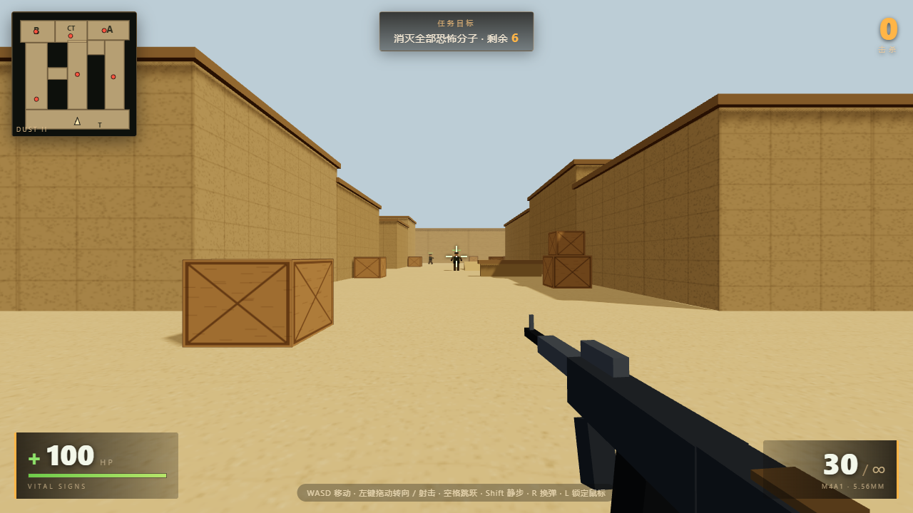

# DUST STRIKE · 反恐精英风格 3D FPS

一个可直接在桌面浏览器运行的 de_dust2 简化版 3D 射击小游戏。
Three.js 通过官方 CDN 加载，前端使用原生 ES Module 拆分，**不需要安装任何前端依赖、也不需要打包构建**。



## 目录结构

```
dust2-fps/
├── index.html              # 页面骨架：HUD、开始/暂停/结算界面、加载提示
├── css/
│   └── game.css            # 全部界面样式（准星、血条、小地图、弹窗）
├── js/
│   ├── game.js             # 主流程：射击判定、换弹、胜负、主循环、输入绑定
│   ├── core/
│   │   ├── three.js        # Three.js CDN 加载器（unpkg → jsdelivr → esm.sh）
│   │   ├── config.js       # 数值配置：移动速度、跳跃、伤害、弹药、地图尺寸
│   │   ├── state.js        # 全局状态：玩家、按键、输入标志、死亡回调
│   │   └── input.js        # 键鼠事件、鼠标拖拽转向、指针锁定
│   ├── world/
│   │   ├── scene.js        # 渲染器、主相机、灯光、枪械独立场景
│   │   ├── map.js          # de_dust2 简化地图、碰撞体、地面/箱顶高度查询
│   │   ├── textures.js     # 程序化沙地、墙面、木箱贴图与材质
│   │   ├── effects.js      # 曳光弹、命中火花、血雾、弹孔
│   │   ├── audio.js        # WebAudio 合成枪声、命中、受伤、换弹音效
│   │   └── weapon.js       # 第一人称枪械模型、后坐力与摆动动画
│   ├── entities/
│   │   ├── player.js       # 移动、跳跃、视角同步、受伤与死亡
│   │   └── bots.js         # 敌方 AI 状态机、生成与死亡处理
│   └── ui/
│       ├── dom.js          # 统一 DOM 引用
│       ├── hud.js          # 血量、弹药、击杀、准星、小地图、击杀信息
│       └── screens.js      # 开始 / 暂停 / 结算界面切换
├── server.js               # Node.js 静态文件服务器（零第三方依赖）
├── server.py               # Python 静态文件服务器（仅标准库）
├── README.md
├── screenshot.png          # 游戏内截图
└── screenshot-menu.png     # 开始界面截图
```

模块之间通过 ES Module 的 `import` / `export` 通信；敌人列表、死亡事件等通过注入回调和
`state.js` 中的 `hooks` 传递，避免循环依赖。想改手感只需看 `js/core/config.js`，
想改地图布局看 `js/world/map.js`，想改 AI 看 `js/entities/bots.js`。

## 方式一：Node.js 启动

要求：Node.js 16+（已在 Node 24 上验证）。

```bash
cd dust2-fps
node server.js
```

浏览器访问：<http://127.0.0.1:8080/>

指定端口：

```bash
node server.js 3000
```

## 方式二：Python 启动

要求：Python 3.8+（已在 Python 3.15 上验证）。

```bash
cd dust2-fps
python server.py
```

浏览器访问：<http://127.0.0.1:8080/>

指定端口：

```bash
python server.py 3000
```

脚本会打印实际访问地址；端口被占用时自动尝试下一个端口（最多 +20）。
两个脚本都只做一件事：把当前目录作为静态站点托管，并禁用缓存，方便改完代码刷新即生效。

## 操作

| 按键 | 功能 |
| --- | --- |
| W A S D | 前后左右移动 |
| 鼠标左键 | 射击（按住连发），拖动可转向 |
| 鼠标右键 | 拖动转向 |
| 空格 | 跳跃 |
| Shift | 静步 |
| C | 蹲下（按住，降低视点、减速、收束弹道） |
| R | 换弹 |
| L | 锁定 / 释放鼠标 |
| Esc | 暂停菜单：继续战斗 / 重新开始 / 退出游戏 |

## 玩法

- 生命值 100，被击中扣血，归零任务失败。
- 清除地图上 6 名敌人即胜利，HUD 显示剩余敌人、击杀数、血量、弹药。
- 敌人具备巡逻、警戒、追踪、射击、死亡五种行为，会利用掩体与视线。
- 地图包含 T 出生点、中路、A 大通道、A 包点、A 小道、B 洞、B 包点、CT 出生点，
  墙体、木箱、矮墙、斜坡均有碰撞，玩家不可穿墙。

## 注意

- 游戏首次打开需要联网从 CDN 加载 Three.js（unpkg，失败会自动尝试 jsdelivr / esm.sh）。
- 建议使用 Chrome / Edge / Firefox 最新版，窗口尺寸 1280×720 以上。
- 在地址后加 `?auto=1` 可跳过开始界面直接进入游戏（便于截图或演示）。
